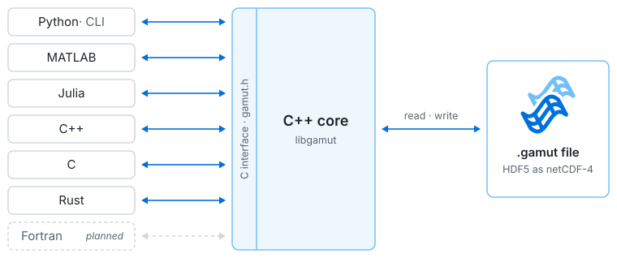

<p align="center">
  <picture>
    <source media="(prefers-color-scheme: dark)" srcset="https://raw.githubusercontent.com/bijective-systems-org/gamut/main/docs/assets/logo-dark.svg">
    <source media="(prefers-color-scheme: light)" srcset="https://raw.githubusercontent.com/bijective-systems-org/gamut/main/docs/assets/logo.svg">
    
  </picture>
</p>

# Gamut: a file format for parametric studies and models, with definitions intact

By [Bijective Systems](https://github.com/bijective-systems-org), with
libraries for Python, MATLAB, Julia, C++, C and Rust.

**[Start here](https://bijective-systems-org.github.io/gamut/first-file.html)** ·
[Documentation](https://bijective-systems-org.github.io/gamut/) ·
[Specification](https://bijective-systems-org.github.io/gamut/reference/specification.html) ·
[PyPI: bijective-gamut](https://pypi.org/project/bijective-gamut/) ·
[Releases](https://github.com/bijective-systems-org/gamut/releases)

<p align="center">
  <a href="https://github.com/bijective-systems-org/gamut/actions/workflows/ci.yml"></a>
</p>

---

Gamut is an open file format for exchanging engineering studies and models
with their definitions intact. Study files describe runs, parameters,
results, units and relationships, including fields on shared or varying
meshes. Those definitions travel with the data, so another person or tool
can inspect the study without reconstructing its meaning from filenames
and separate notes.

Libraries for Python, MATLAB, Julia, C++, C and Rust use one core to read
and write the format, so each reads what another wrote, value for value.
Model files hold their definitions and state as plain data, without
executable code. Declared inputs and outputs can be inspected without the
model implementation. Interpreting its state and evaluating the model
require an implementation of the recorded type in the consuming runtime.

<p align="center">
  <picture>
    <source media="(prefers-color-scheme: dark)" srcset="https://raw.githubusercontent.com/bijective-systems-org/gamut/main/docs/assets/languages-dark.svg">
    
  </picture>
</p>

## First file

Install with `python -m pip install bijective-gamut`. This example
writes one input and one result for each of three runs.

```python
import gamut

# Values at the same position belong to the same run.
alpha = [0.0, 2.0, 4.0]
cl = [0.0, 0.22, 0.44]

with gamut.create(
    "first.gamut",
    writer="example sweep",
    parameters={"alpha": {"units": "degree", "role": "condition"}},
    scalars={"cl": "1"},
) as study:
    study.add_runs({"alpha": alpha, "cl": cl})

with gamut.open("first.gamut") as study:
    lift = study.get_scalar("cl")

print("cl:", " ".join(f"{value:.2f}" for value in lift))
```

```text
cl: 0.00 0.22 0.44
```

[First file](https://bijective-systems-org.github.io/gamut/first-file.html)
shows how to inspect and validate the file and runs the same example in
MATLAB, Julia, C++ and Rust.

For a full study, see the
[capsule aeroheating dataset](https://huggingface.co/datasets/bijective/capsule-aeroheating).

## Performance

<p align="center">
  
</p>

On the triangulated capsule family, Gamut and compressed Exodus occupy
about the same space, and Gamut is smaller and reads one run faster than
PhysicsNeMo-Mesh, which writes faster; on the smaller airfoil sweep,
PhysicsNeMo-Mesh reads faster and Gamut is smaller. PhysicsNeMo-Mesh needs
triangles, so every format here uses the capsule converted to triangles.
The [benchmarks](https://bijective-systems-org.github.io/gamut/benchmarks.html) give the full timings, settings
and machine, the original quadrilateral results, and the workloads where
another approach is faster.

## Install

| Language | Install |
|---|---|
| Python 3.11 or later | `pip install bijective-gamut` |
| MATLAB R2023b or later | open `Gamut.mltbx` from the [latest release](https://github.com/bijective-systems-org/gamut/releases/latest) |
| Julia 1.10 or later | `Pkg.add("GamutFile")` |
| C++ and C | CMake build and install, then `find_package(gamut)`; include `gamut/gamut.hpp` (C++17) or `gamut/gamut.h` (C) |
| Rust 1.70 or later | `bijective-gamut = { git = "https://github.com/bijective-systems-org/gamut", tag = "v2.3.0" }`, with `GAMUT_LIB_DIR` at a release's core |

In Python, install `bijective-gamut`, then `import gamut`; the PyPI project
named `gamut` is a different package. [Installing](https://bijective-systems-org.github.io/gamut/install.html) has
the details for each language, and [llms.txt](https://raw.githubusercontent.com/bijective-systems-org/gamut/main/llms.txt) gives coding
agents a plain-text overview.

## License

[Apache 2.0](https://github.com/bijective-systems-org/gamut/blob/main/LICENSE). Made by [Bijective Systems](https://github.com/bijective-systems-org).
If you use Gamut in published work, please cite it ([CITATION.cff](https://github.com/bijective-systems-org/gamut/blob/main/CITATION.cff)).

Gamut is developed in collaboration with AI coding agents (Claude Code and Codex).
