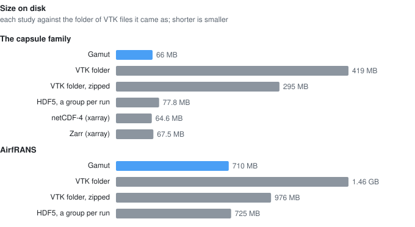
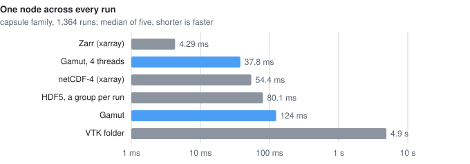
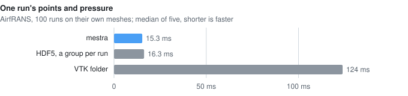

# Benchmarks

What a study costs on disk and how fast its common reads are, as one mestra
file and in the forms teams use today. Two studies of different shapes, the
same reads, every format written from the same data and checked to return
the same numbers.

## What the numbers say

- **Size.** A study as one mestra file takes a sixth of the space of the
  folder of VTK files it came as for the capsule family, and half for
  AirfRANS: about what netCDF and Zarr take, and less than HDF5 written a
  run at a time.
- **One run** reads in about a millisecond on the capsule family's small
  mesh, most of it opening the file (HDF5 written a run at a time opens in
  a third of the time), and in 15 ms on an AirfRANS mesh, as fast as HDF5
  and eight times faster than reading the run's VTK file.
- **Runs by condition** take a millisecond, as fast as a Parquet table and
  sixty times faster than visiting HDF5 run by run.
- **Reads across runs are where the layout shows.** mestra's default
  chunks are shaped for reading whole runs, so on a small mesh one node
  across all 1,364 runs decompresses the whole field: 127 ms, or 38 ms with
  four threads, against 4 ms for Zarr's default chunks. It is still thirty
  times faster than opening 1,364 VTK files.
- **Writing** the capsule family takes 1.3 s, against 10 s for the VTK
  files. Zarr writes fastest, with zstd on many threads; mestra uses gzip,
  which every netCDF and HDF5 reader can decompress.

## The two studies

**A capsule family.** Our own: 44 capsule shapes meshed with one topology
by a mapping tool, each run at 31 conditions (Mach number, angle of attack,
sideslip), with surface pressure and heating from engineering methods
(modified Newtonian pressure, laminar heating by Lees' similarity) on
6,722 nodes. Many runs, a small mesh, the geometry per shape. Not public.

**AirfRANS.** Public: 100 runs of the AirfRANS dataset (Bonnet et al.,
NeurIPS 2022; ODbL), two-dimensional RANS solutions around NACA 4-digit
airfoils from OpenFOAM, each on its own mesh of about 177,000 nodes, with
pressure, velocity and turbulent viscosity at nodes and cells. Few runs,
large meshes, a mesh per run. `bench/airfrans.py` fetches the same subset.

## Size on disk

## Reads

### The capsule family

<!-- results: capsule -->
| Format | Size | Write | Open | One run | One node, every run | A region, every run | Runs by condition |
|---|---:|---:|---:|---:|---:|---:|---:|
| **mestra** | 66 MB | 1.31 s | 810 µs | 1.19 ms | 127 ms | 128 ms | 1.05 ms |
| **mestra, 4 threads** | 66 MB | — | 831 µs | 1.23 ms | 38.3 ms | 38.8 ms | 1.07 ms |
| VTK folder | 419 MB | 10.4 s | 2.22 ms | 2.77 ms | 4.44 s | 5.38 s | 2.6 ms |
| VTK folder, zipped | 295 MB | 12.2 s | — | — | — | — | — |
| HDF5, a group per run | 79.8 MB | 2.62 s | 287 µs | 299 µs | 83.6 ms | 88.8 ms | 66.8 ms |
| netCDF-4 (xarray) | 64.6 MB | 1.5 s | 5.58 ms | 56.4 ms | 55 ms | 75.5 ms | 5.54 ms |
| Zarr (xarray) | 67.5 MB | 202 ms | 2.37 ms | 4.49 ms | 4.28 ms | 5.28 ms | 3.65 ms |
| Parquet, run table only | 0.14 MB | 66.6 ms | — | — | — | — | 956 µs |
<!-- end -->

### AirfRANS

<!-- results: airfrans -->
| Format | Size | Write | Open | One run | Runs by condition |
|---|---:|---:|---:|---:|---:|
| VTK folder | 1.46 GB | — | 321 µs | 125 ms | 362 µs |
| VTK folder, zipped | 976 MB | 39.9 s | — | — | — |
| **mestra** | 710 MB | 53.4 s | 688 µs | 14.9 ms | 721 µs |
| HDF5, a group per run | 994 MB | 38.3 s | 89 µs | 13.8 ms | 2.93 ms |
<!-- end -->

## How it was measured

- **Formats.** mestra; the folder of VTK files the runs came as (written
  by PyVista with its defaults for the capsule family, the published files
  for AirfRANS) with a `parameters.csv` of the run table; that folder
  zipped; HDF5 written with h5py, a group per run with each field a
  gzip-compressed dataset and the run's parameters as attributes;
  netCDF-4 and Zarr written by xarray with their default chunking and
  compression (zlib level 4 for netCDF); and the run table alone as
  Parquet. netCDF and Zarr have no standard layout for a set of different
  meshes, so they appear for the capsule family only. The AirfRANS files
  carry three integer id arrays that the mestra and HDF5 copies leave out.
- **Reads.** *Open*: open the study and list what it holds. *One run*: one
  run's pressure (with its points, for AirfRANS). *One node, every run* and
  *a region, every run*: the pressure at one node, or at 672 consecutive
  nodes, in all 1,364 runs. *Runs by condition*: choose the runs with Mach
  number above 20 and positive angle of attack (inflow speed above 50 m/s
  and angle above 5°, for AirfRANS) and read a result of each.
- **Timing.** Each format is measured in a fresh process, so no library's
  cache serves another. Each read opens and closes the file, as a script
  does. Times are the median of five, after one untimed read; the files
  are in the operating system's cache (clearing it needs administrator
  rights), so they measure decoding and library work rather than the disk.
  Writes are timed once, from arrays in memory (the capsule family) or
  from the published VTK files (AirfRANS, where every format reads them).
  From one run of the whole benchmark to the next, medians moved by up to
  a third.
- **Checks.** For every read, every format returns the same numbers.
- **Machine.**
<!-- results: machine -->
Apple M3, 8 GB, macOS-27.0.1-arm64-arm-64bit; Python 3.11.11; mestra 1.0.0.dev0, numpy 2.4.6, h5py 3.16.0, netCDF4 1.7.5, xarray 2026.9.0, zarr 3.1.6, pyarrow 26.0.0, pandas 3.0.6, pyvista 0.49.1, vtk 9.7.1; mestra built from 3f40920.
<!-- end -->

The scripts are in [`bench/`](../bench), the results beside them in
`bench/results/`, and this page's tables and figures are generated from
those results by `bench/figures.py`.
